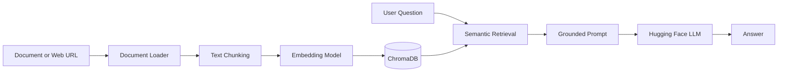

# RAGBot

[](https://github.com/CharanBantumilli/RAGBot/actions/workflows/ci.yml)
[](https://www.python.org/)
[](LICENSE)

RAGBot is a document-grounded conversational AI application built with Python, LangChain, ChromaDB, Hugging Face models, and Gradio. Upload a PDF, text, CSV, DOCX, or web content, then ask questions that are answered using retrieved document context.

> RAGBot reduces unsupported answers by using retrieval context and an explicit instruction to respond only from available evidence.

## Features

- PDF, TXT, CSV, DOCX, and web-page ingestion
- Recursive text chunking and overlap
- Persistent or in-memory ChromaDB vector storage
- Hugging Face embedding and generation models
- Document-grounded prompt guardrails
- Lazy model loading and prompt caching
- Interactive Gradio chat interface
- Pytest, Ruff, and CI configuration

## How it works



## Requirements

- Python 3.10 or newer
- Pip or an equivalent Python package manager
- A Hugging Face access token
- Optional: NVIDIA GPU or Apple Silicon for accelerated inference

## Quick start

```bash
git clone https://github.com/CharanBantumilli/RAGBot.git
cd RAGBot
python -m venv .venv
source .venv/bin/activate
python -m pip install --upgrade pip
python -m pip install -e ".[dev]"
```

On Windows, activate the environment with:

```powershell
.venv\Scripts\Activate.ps1
```

Copy the environment template:

```bash
cp .env.example .env
```

Set your Hugging Face token in `.env`:

```dotenv
HUGGINGFACEHUB_API_TOKEN=hf_your_token_here
```

Launch RAGBot:

```bash
python -m ragbot
```

Open `http://127.0.0.1:7860` in a browser.

## Docker

```bash
docker build -t ragbot .
docker run --rm -p 7860:7860 --env-file .env ragbot
```

## Configuration

| Variable | Default | Description |
|---|---|---|
| `HUGGINGFACEHUB_API_TOKEN` | — | Hugging Face API token |
| `RAGBOT_HF_TOKEN` | — | Alternative Hugging Face token variable |
| `RAGBOT_EMBEDDING_MODEL_NAME` | `intfloat/multilingual-e5-small` | Sentence embedding model |
| `RAGBOT_LLM_MODEL_NAME` | `deepseek-ai/DeepSeek-R1-Distill-Qwen-1.5B` | Text generation model |
| `RAGBOT_CHUNK_SIZE` | `500` | Maximum characters in each chunk |
| `RAGBOT_CHUNK_OVERLAP` | `50` | Characters reused between adjacent chunks |
| `RAGBOT_MAX_NEW_TOKENS` | `200` | Maximum response length |
| `RAGBOT_TEMPERATURE` | `0.5` | Generation sampling temperature |
| `RAGBOT_DEVICE_MAP` | `auto` | PyTorch device placement |
| `RAGBOT_CHROMA_PERSIST_DIRECTORY` | — | Optional ChromaDB persistence directory |

## Development

```bash
make test
make lint
make format
```

Run a direct test command:

```bash
pytest tests -v --tb=short
```

See [CONTRIBUTING.md](CONTRIBUTING.md) for development and pull-request guidance.

## Limitations

- Model downloads require network access and may use substantial disk and memory.
- Answers depend on retrieval quality and the ingested document's content.
- The Gradio interface is intended for local or controlled deployments; add authentication and network controls before exposing it publicly.
- Large documents can significantly increase ingestion time and memory use.

## Security

Keep API tokens out of source code and never upload private documents to untrusted deployments. See [SECURITY.md](SECURITY.md) for vulnerability reporting guidance.

## License

Released under the [MIT License](LICENSE).
